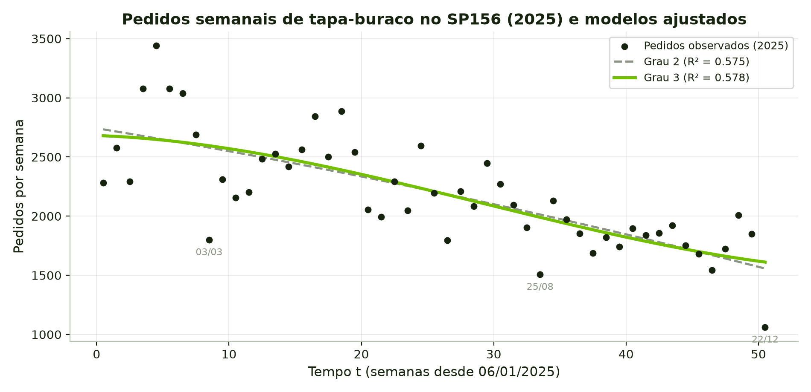
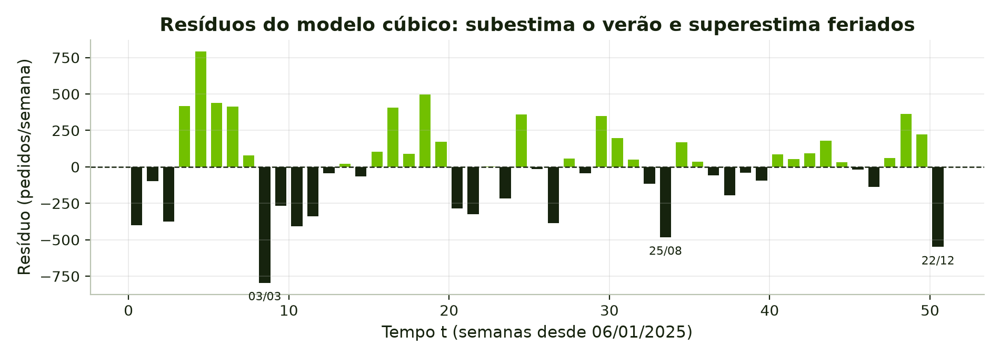
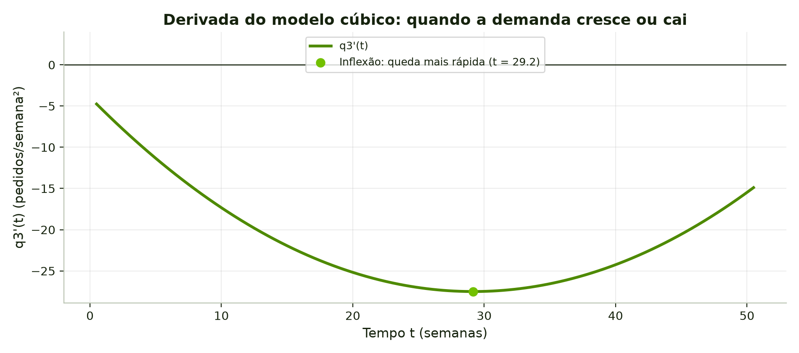
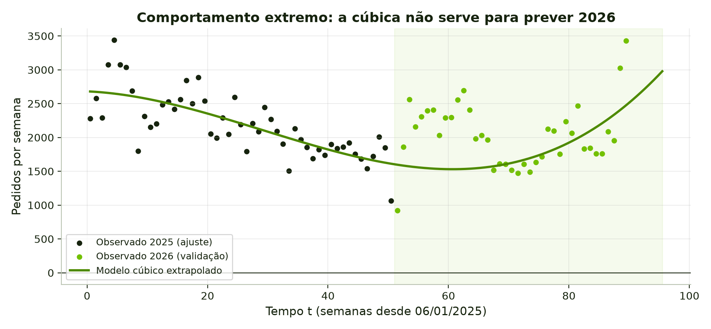
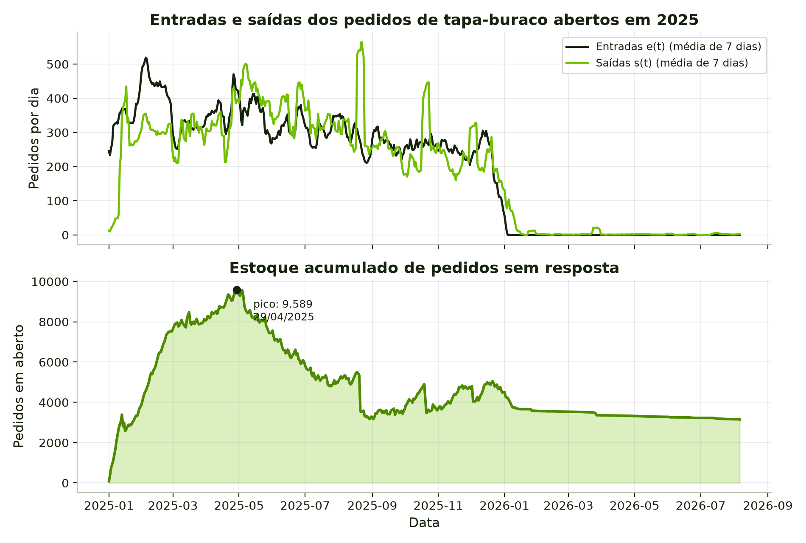
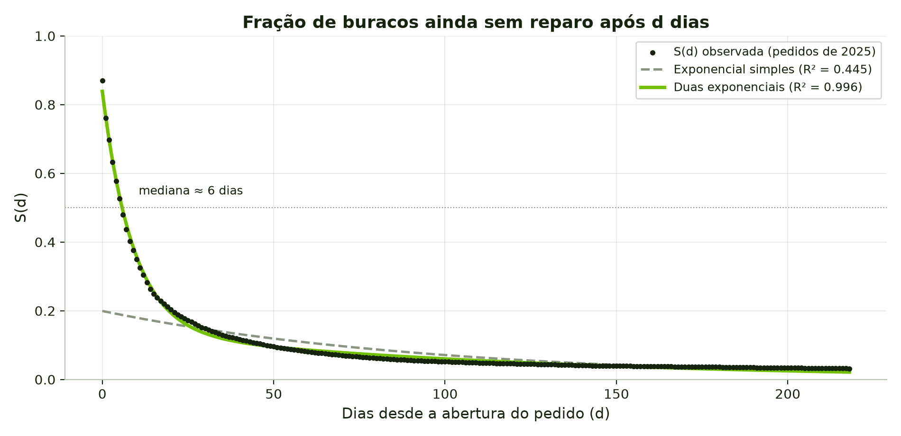
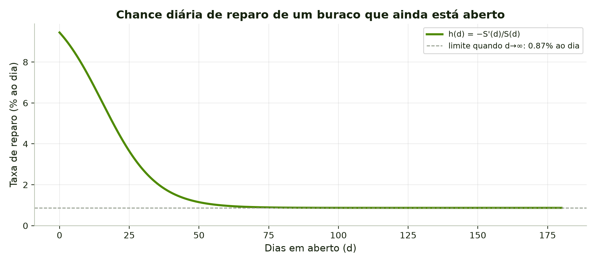
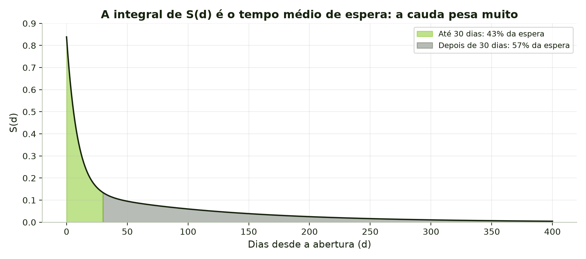

<p align="center">
  
</p>

<h3 align="center">Differentiated Problem Solving · cálculo aplicado aos pedidos de tapa-buraco de São Paulo</h3>

<p align="center">
  FIAP · Global Solution 2026.2 · CitizenTech · Engenharia de Software, 1º ano
</p>

---

## Ficha da CitizenTech

| Campo | Olho na Via |
|---|---|
| Nome da CitizenTech | **Olho na Via**: fiscalização urbana com IA |
| Cidade e bairro | São Paulo (SP). Piloto proposto: linhas de ônibus que cruzam a região central e a Av. Paulista (entorno da FIAP Paulista) e seguem até bairros da periferia, em duas subprefeituras a definir com a Prefeitura. Esta análise usa os pedidos de tapa-buraco da cidade inteira. |
| Cidadão beneficiado | Quem usa a rua todos os dias: passageiros de ônibus, motociclistas e entregadores, ciclistas, pedestres (principalmente idosos e pessoas com deficiência) e moradores de áreas que alagam. Também o gestor público, que precisa decidir onde agir primeiro. |
| Problema, em uma frase | Em São Paulo, buracos, alagamentos, faixas apagadas e semáforos apagados só entram na fila de reparo quando alguém reclama, e ninguém confere de forma sistemática se o conserto foi bem feito. |
| Como funciona | Um dispositivo IoT com câmera, acelerômetro e GPS, instalado em ônibus, e a análise das câmeras do Smart Sampa detectam problemas com IA. O sistema abre o chamado no órgão responsável, prioriza pela gravidade e, quando o ônibus passa de novo, confirma se o reparo foi feito. Também avisa cidadãos e ambulâncias sobre vias alagadas ou bloqueadas. Cidadãos contribuem pelo app e com um kit próprio em troca de créditos. |
| O que cada parte faz | **Sensor (Edge/ESP32):** mede impacto, lâmina d'água e luz e decide o estado sozinho · **Lógica (Python):** organiza os chamados, calcula a prioridade e guarda os dados · **DPS (este repositório):** modela, com dados reais do SP156, quando os pedidos chegam, quanto acumulam sem resposta e quanto tempo esperam, e mostra onde está o maior custo do atraso · **Interface e Interação (React):** landing, app do cidadão, painel do gestor e dados abertos · **Experiência:** jornada, requisitos e roadmap · **Pitch:** a história em 3 minutos. |
| Link do repositório | DPS: [github.com/olho-na-via/differentiated-problem-solving](https://github.com/olho-na-via/differentiated-problem-solving) · Backend: [github.com/olho-na-via/backend](https://github.com/olho-na-via/backend) · Frontend: [github.com/olho-na-via/frontend](https://github.com/olho-na-via/frontend) |
| Indicador de impacto | **Tempo entre o surgimento do problema e o reparo confirmado** (meta: de 6 para no máximo 3 dias nas áreas piloto) e **% de problemas detectados antes de qualquer reclamação** (meta: 60% ou mais). |
| ODS conectados | `ODS 11` `ODS 9` `ODS 3` `ODS 13` `ODS 10` `ODS 16 · complementar` |
| Equipe | **Erick Nathan Capito Pereira** · RM573635 |

## Sobre

Esta é a parte de **Differentiated Problem Solving** do Olho na Via. Ela aplica limites, derivadas e integrais aos **113.086 pedidos de tapa-buraco** abertos no SP156 em 2025 e valida o modelo com os **79,5 mil pedidos** de janeiro a setembro de 2026.

O trabalho responde a três perguntas, uma para cada etapa da vida de um pedido:

| Pergunta | Modelo | Cálculo usado |
|---|---|---|
| **1. Demanda:** como a taxa de pedidos varia ao longo do ano e quanto ela acumula? | Polinômio de grau 3, q₃(t), ajustado por mínimos quadrados | Taxa média de variação, derivada pela definição, pontos críticos, inflexão, integral definida, limite no infinito |
| **2. Fila:** quando o estoque de pedidos sem resposta cresce? | B(t) = ∫₀ᵗ [e(u) − s(u)] du | Integral acumulada, Teorema Fundamental do Cálculo, sinal de B′(t) |
| **3. Espera:** quanto tempo um buraco espera e onde está o maior custo? | S(d) = A·e^(−λr·d) + B·e^(−λl·d) | Limites laterais e no infinito, derivada, taxa de reparo h(d), integral imprópria, convergência de D(k) |

**Questão orientadora:** a cidade perde mais com a demora típica ou com os poucos buracos que ficam abertos por muito tempo?

**Resposta:** com a cauda. A mediana de espera é de **6 dias**, mas o tempo médio, calculado pela integral imprópria, é de **22,6 dias**. **57% de toda a espera** acontece depois do 30º dia, concentrada em **13% dos pedidos**.

| 113.086 | 6 → 22,6 dias | 57% | 9.589 |
|:---:|:---:|:---:|:---:|
| pedidos de tapa-buraco em 2025 | mediana observada e média pela integral imprópria | da espera total acontece depois de 30 dias | pedidos em aberto no pico da fila (29/04/2025) |

## Resultados

### Parte 1 · Demanda semanal

Nas 51 semanas completas de 2025 foram 111.524 pedidos, com média de 2.186,7 por semana. O máximo, 3.441, foi na semana de 03/02, no auge das chuvas; o mínimo, 1.062, na semana do Natal. Os modelos de grau 2 e 3 explicam cerca de 58% da variação (R² = 0,575 e 0,578).



Os resíduos têm sequências de mesmo sinal: há sazonalidade (verão chuvoso) e efeito de feriados que um polinômio não captura. As maiores superestimações caem nas semanas de 03/03 (Carnaval), 22/12 (Natal) e 25/08.



A derivada foi obtida primeiro pela definição: `sympy.limit` do quociente de Newton devolve q₃′(t) = 3at² + 2bt + c, e os quocientes numéricos em t₀ = 20,5 convergem para −25,42. Os dois pontos críticos (t = −2,35 e t = 60,68) ficam fora de 2025, então o modelo é estritamente decrescente no ano. A inflexão em t = 29,2 semanas, no fim de julho, marca a queda mais rápida: −27,50 pedidos/semana².



A integral ∫₀⁵¹ q₃(t) dt = 111.523,6 reproduz a soma observada (111.524). Mas o limite no infinito mostra o risco de extrapolar: com coeficiente líder positivo, q₃(t) → +∞. Na validação de janeiro a setembro de 2026, o modelo prevê 68.976 pedidos contra 79.458 observados (−13,2%).



### Parte 2 · Estoque de pedidos em aberto

O estoque de pedidos sem resposta é a integral das entradas menos as saídas. Pelo Teorema Fundamental do Cálculo, B′(t) = e(t) − s(t): a fila cresce enquanto entra mais do que sai. Ela chegou a **9.589 pedidos em 29/04/2025**, quando a derivada trocou de sinal. De janeiro a abril, ∫(e − s) = +9.434; de maio a agosto, −6.143. Em 06/08/2026, 3.153 pedidos de 2025 (2,8%) ainda estavam abertos.



### Parte 3 · Tempo até o reparo

S(d) é a fração dos 112.540 pedidos não cancelados ainda sem reparo após d dias. A exponencial simples (R² = 0,445) não representa ao mesmo tempo a queda rápida e a cauda longa. O modelo de duas exponenciais (R² = 0,996) separa os casos rápidos, com meia-vida de 6,2 dias, da cauda lenta, com meia-vida de 80 dias.



A taxa de reparo h(d) = −S′(d)/S(d) cai de 9,3% ao dia (pedido aberto há 1 dia) para 0,87% ao dia (aberto há 90 dias), e tende a λl quando d → ∞. Quanto mais tempo na fila, menor a chance de atendimento.



O tempo médio de espera é a integral imprópria E[T] = ∫₀^∞ S(d) dd = A/λr + B/λl = **22,64 dias**, quase quatro vezes a mediana. A área depois do 30º dia corresponde a 57% de toda a espera.



Por fim, o custo do atraso retoma a ideia da proposta inicial como cenário. Se o dano de um buraco cresce como e^(kd), o dano acumulado é D(k) = A/(λr − k) + B/(λl − k), que só converge se k < λl = 0,87% ao dia. Com k = 0,5% ao dia o dano esperado dobra; com 0,8%, fica 9,4 vezes maior.

## O que os resultados mudam no Olho na Via

| Resultado matemático | Decisão para o protótipo |
|---|---|
| q′ < 0 em 2025, mas lim q₃ = +∞ e erro de −13% em 2026 | Recalibrar o dimensionamento a cada trimestre com dados novos; nunca extrapolar polinômios |
| B′(t) = e(t) − s(t) positiva por meses antes do pico | Alerta no painel do gestor quando a média de 14 dias de e(t) − s(t) ficar positiva |
| Mediana de 6 dias, média de 22,6; 57% da espera após 30 dias | Verificação obrigatória e reabertura automática de todo chamado com mais de 30 dias |
| h(d) decrescente, tendendo a 0,87% ao dia | Manter a variável T (tempo em aberto) no Índice de Prioridade da Via, com peso crescente, para que casos antigos subam na fila |
| D(k) converge só se k < λl | Meta principal do piloto: aumentar λl (encurtar a cauda), além de reduzir a mediana de 6 para 3 dias |

## Como rodar

Requisitos: Python 3.10 ou mais novo.

```bash
pip install -r requirements.txt
python app.py
```

O `app.py` leva cerca de 15 segundos. Ele imprime as quatro partes no terminal, recria os oito gráficos em `figuras/` e regrava `resultados.json`. Antes de modelar, confere a base e para com erro se algum critério falhar:

```
[OK] Total de 2025 igual ao divulgado pela SMSUB (113,1 mil)
[OK] Semanas completas e consecutivas
[OK] Sem contagens negativas
[OK] Sem valores ausentes
[OK] Sobrevivência não crescente
```

Para o notebook, abra o `app.ipynb` no Jupyter, no VS Code ou no Google Colab (no Colab, envie também a pasta `dados/`). O `seaborn` só é usado no notebook.

O `preparar_dados.py` **não precisa** ser executado: as bases já estão em `dados/`. Ele existe para mostrar como elas foram geradas e precisa dos microdados trimestrais do SP156 (cerca de 800 MB) na pasta `microdados/`, com os nomes `2025_1.csv` a `2026_3.csv`, ou em outra pasta indicada na variável de ambiente `MICRODADOS_SP156`.

## Origem dos dados

Os dados são **públicos e oficiais**, sem nenhum dado pessoal: a análise usa só datas, serviço e status dos pedidos, já agregados por dia ou por semana.

| | |
|---|---|
| Fonte | Portal de Dados Abertos da Prefeitura de São Paulo, conjunto [Dados do SP156 – Solicitações](https://dados.prefeitura.sp.gov.br/dataset/dados-do-sp156) |
| Período | Arquivos trimestrais do 1º TRI de 2025 ao 3º TRI de 2026, cerca de 4,1 milhões de protocolos de todos os serviços |
| Consulta | 09/11/2026 |
| Recorte | Serviço "Tapa-buraco": data de abertura, data de finalização e status (Finalizada, Aberto, Cancelada ou Em andamento) |
| Conferência | O total de 2025 bate com os 113,1 mil pedidos divulgados pela Secretaria Municipal das Subprefeituras (SMSUB) |

As três bases geradas pelo `preparar_dados.py`:

| Base | Colunas | Significado |
|---|---|---|
| `tapa_buraco_semanal.csv` | `inicio_semana`, `fim_semana`, `pedidos` | Pedidos abertos por semana, de segunda a domingo, de 06/01/2025 a 27/09/2026. A semana elimina o ciclo semanal (cerca de 380 pedidos por dia útil contra 150 aos domingos) |
| `coorte_2025_diaria.csv` | `data`, `entradas`, `finalizadas`, `canceladas` | Fluxos diários dos pedidos abertos em 2025, até 06/08/2026 |
| `sobrevivencia_2025.csv` | `dias`, `reparados_ate_d`, `fracao_sem_reparo` | S(d): fração dos pedidos não cancelados de 2025 ainda sem reparo após d dias, de 0 a 218 |

Dois problemas dos arquivos oficiais foram detectados e tratados: o 1º TRI de 2025 tem exatamente 1.048.575 linhas, o limite do Excel; e o 3º TRI de 2026 usa vírgula como separador e datas no formato mês/dia. O `preparar_dados.py` descobre o separador pelo cabeçalho e o formato da data pelo que coloca mais aberturas dentro do trimestre.

## Validações

Cada resultado foi conferido por um segundo caminho, e o `app.py` usa `assert` para parar se algum não bater:

| Resultado | Conferido com |
|---|---|
| Derivada manual 3at² + 2bt + c | Limite do quociente de Newton (`sympy.limit`) e `numpy.polyder` |
| Primitiva manual de q₃ | `scipy.integrate.quad` (e `numpy.polyint` no notebook) |
| R² e RMSE calculados à mão | Soma dos quadrados dos resíduos devolvida pelo `numpy.polyfit` |
| B(t) pela soma exata das contagens | Trapézios da média móvel (`cumulative_trapezoid`): diferença menor que 1% no pico |
| Integral imprópria A/λr + B/λl | `sympy.integrate` até o infinito, regra de Simpson 1/3 implementada à mão e trapézios sobre os dados |
| D(k) pela fórmula fechada | `scipy.integrate.quad` em k = 0,005 |
| Modelo de demanda | Validação fora da amostra, com os dados de 2026 |

## Limitações

- **Pedido não é buraco.** Um mesmo buraco pode gerar vários pedidos, e muitos nunca são reportados. Os modelos descrevem o fluxo de chamados, que é o que a Prefeitura opera hoje.
- O modelo de demanda foi ajustado com um único ano e explica 58% da variação semanal: serve para a tendência, não para semanas específicas.
- S(d) supõe que todo buraco acaba reparado (lim S = 0). Com 218 dias de dados, não se distingue uma cauda muito lenta de uma fração que nunca é reparada.
- A taxa k de crescimento do dano é hipotética e foi tratada só como cenário.
- A queda brusca das saídas no fim de agosto de 2025 sugere um fechamento em lote, que precisa ser confirmado com a Prefeitura.

## Estrutura

```
app.py                  # análise completa: terminal, figuras/ e resultados.json
app.ipynb               # a mesma análise em notebook, no padrão das aulas
preparar_dados.py       # microdados do SP156 → dados/
resultados.json         # números calculados, lidos pelo relatório
requirements.txt        # bibliotecas usadas
Relatorio Tecnico - DPS - Olho na Via.pdf
dados/                  # bases agregadas (semanal, coorte diária, sobrevivência)
figuras/                # gráficos p1_*, p2_* e p3_*
docs/logo.svg           # logo do Olho na Via
```

## Uso de IA

Os prompts enviados ao assistente de IA, na ordem em que aconteceram, estão em [prompts.md](prompts.md).

## Referências

1. PREFEITURA DE SÃO PAULO. *Dados do SP156 – Solicitações*, 1º TRI 2025 a 3º TRI 2026. Portal de Dados Abertos. Acesso em: 09 nov. 2026.
2. PREFEITURA DE SÃO PAULO. *Glossário da Base de Dados do SP156 – 2020 em diante*. Atualizado em 10 ago. 2026.
3. BNEWS SÃO PAULO. *Mesmo após recapeamento, SP registra quase 52 mil pedidos de tapa-buraco*. 09 ago. 2026.
4. STEWART, J. *Cálculo*, v. 1. São Paulo: Cengage Learning.
5. OPENSTAX. *Calculus*, volumes 1 e 2.
6. FIAP. *Differentiated Problem Solving*: notebooks das Aulas 05, 06, 07, 12 a 16, 18 e 19 e exercício de revisão para a GS, 2026.2.

## Autor

Erick Nathan Capito Pereira · RM573635
